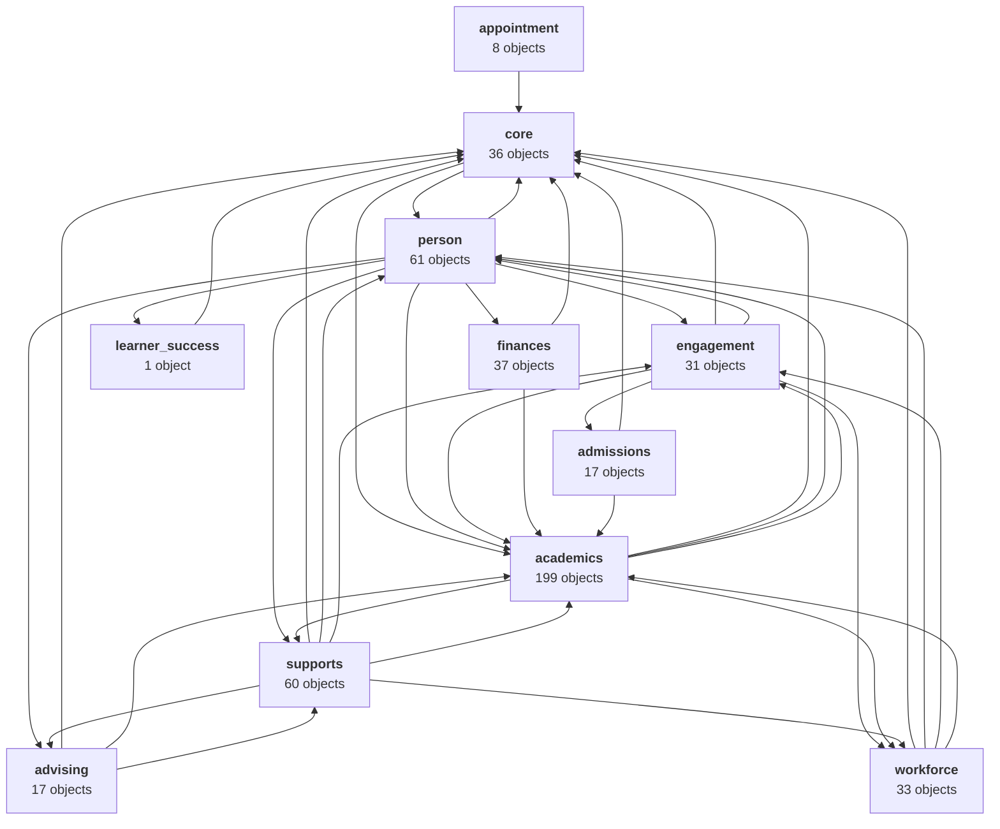

# GUIDE Data Model 1.0.0 — Data Model

This directory documents the GUIDE Data Model 1.0.0. The reference for the model is the `Objects` object in `[../../guide_data_model_schema_v1.0.0.json](../../guide_data_model_schema_v1.0.0.json)` (`sheets.Objects.records`): one record per column, 7,943 in all. Every page here is generated from it.

## Where to start

- **[Data types](data-types.md)** — how the model's generic data types map to PostgreSQL.
- **[Entity relationship explorer](ERD--all_entities.html)** — interactive, searchable view of every object, its columns, what it references, and what references it. Download the file and open it in a browser.

## Entity reference

The model is organized into 11 entities. Each entity is one PostgreSQL schema in the generated DDL.

| Entity          | Schema            | Objects | Columns | Documentation                                     |
| --------------- | ----------------- | ------- | ------- | ------------------------------------------------- |
| Core            | `core`            | 36      | 649     | [core.md](entities/core.md)                       |
| Person          | `person`          | 61      | 1,031   | [person.md](entities/person.md)                   |
| Engagement      | `engagement`      | 31      | 530     | [engagement.md](entities/engagement.md)           |
| Academics       | `academics`       | 199     | 2,874   | [academics.md](entities/academics.md)             |
| Appointment     | `appointment`     | 8       | 133     | [appointment.md](entities/appointment.md)         |
| Advising        | `advising`        | 17      | 330     | [advising.md](entities/advising.md)               |
| Finances        | `finances`        | 37      | 672     | [finances.md](entities/finances.md)               |
| Learner Success | `learner_success` | 1       | 12      | [learner_success.md](entities/learner_success.md) |
| Supports        | `supports`        | 60      | 878     | [supports.md](entities/supports.md)               |
| Workforce       | `workforce`       | 33      | 518     | [workforce.md](entities/workforce.md)             |
| Admissions      | `admissions`      | 17      | 316     | [admissions.md](entities/admissions.md)           |

**Total: 500 objects, 7,943 columns, 1,818 FK reference rows in** `Objects`**, 1,781 generated FK constraints, and 1,200 indexes.**

## Schema relationship diagram

The diagram shows cross-schema foreign-key dependencies in the generated DDL. An arrow from **A → B** means schema A contains at least one table with a foreign key that references a table in schema B. `core` holds the `Tenant` table that every tenant-scoped table references.

## How the documentation is organized

Each per-entity page lists that entity's tables alphabetically. For each table you'll see:

- Model name (e.g. `CourseLookup`) and SQL name (e.g. `academics.course_lookup`)
- The table description from `ObjectDesc`
- Every column with its PostgreSQL type, key status (PK/FK with its `FKReference` target), nullability, and description

Columns appear in the same order as in `Objects`. To navigate by topic rather than by entity, follow the FK references (`FK → Table.Column`) or use the relationship explorer.

## Key conventions

- **Tenant scope.** `TenantIdentifier` (UUID) is the data-ownership and security boundary. Tenant-owned tables include it as the first primary-key column and reference `core.tenant`.
- **Organizations are not tenants.** `OrganizationIdentifier` identifies a real-world organization within a tenant.
- **Lineage.** `SourceSystemIdentifier`, `SourceSystemKeyValue`, and the `SourceSystemCreatedDate`/`UpdatedDate`/`DeletedDate` columns record where a row came from.
- **Audit columns.** `CreatedBy`, `CreatedDate`, `UpdatedBy`, `UpdatedDate`, `DeletedBy`, and `DeletedDate` appear on most tables; deletes are soft.
- **Naming.** Boolean-style columns end in `Indicator`, lookup tables end in `Lookup`, and child or history tables may use the parent key plus `SequenceNumber`.

The reasoning behind these conventions is recorded in the `Decisions` sheet of the model JSON (`sheets.Decisions.records`, 132 decisions).